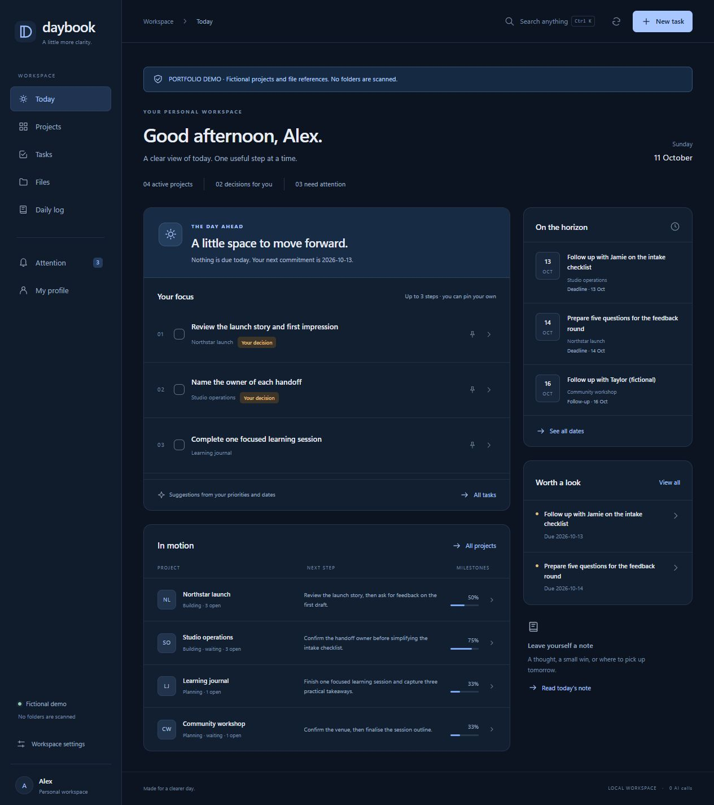
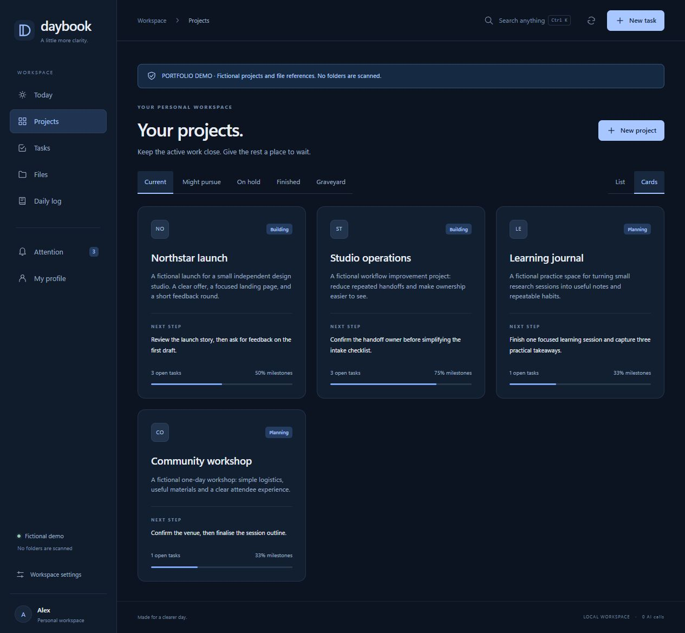
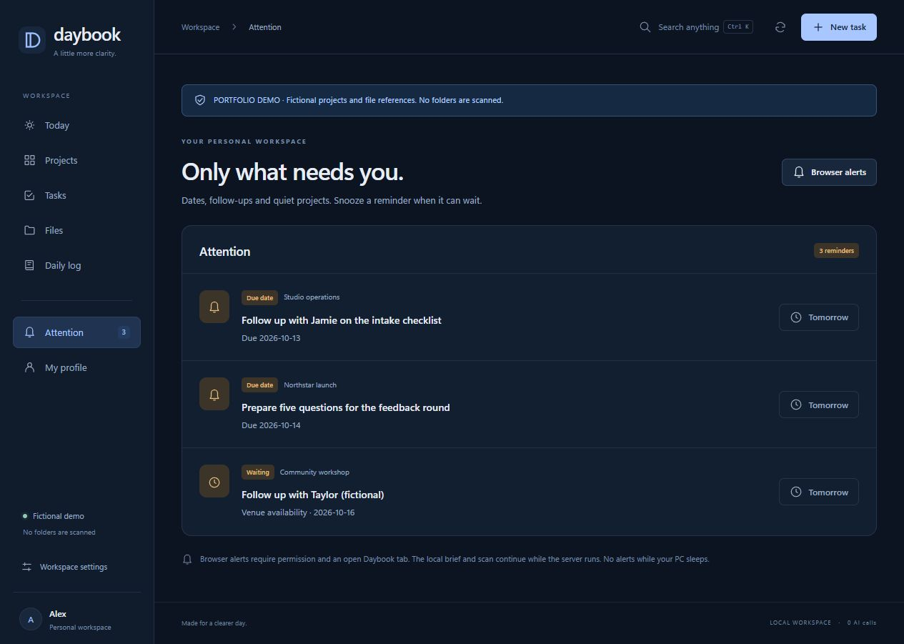
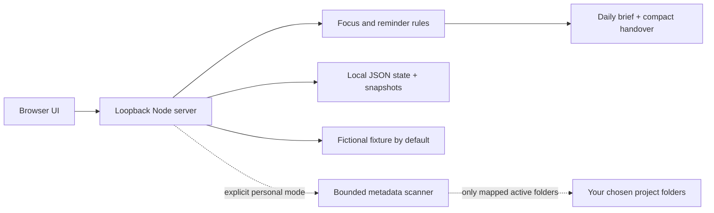

# Daybook

### A little more clarity. A local-first workspace for the day ahead.

Daybook turns a scattered project list into three useful next steps, upcoming commitments and a small attention queue. It pairs a minimal navy interface with predictable local rules—no AI calls, accounts or cloud backend are needed to run it.

**Portfolio project by [Nathan Woo](https://github.com/nathanwoork)** · Product direction and AI-assisted implementation · Node.js + vanilla JavaScript · Zero external runtime dependencies



*An actual screenshot of the runnable sample. Alex, the projects, contacts and file references are fictional. The original personal workspace and its data are not in this repository.*

[Case study for employers](docs/CASE_STUDY.md) · [Set up your own copy](docs/SETUP.md) · [Architecture](docs/ARCHITECTURE.md) · [What it stores](docs/DATA_AND_PRIVACY.md) · [Verification](docs/VERIFICATION.md)

## Try it locally

With Node.js **22 or newer** and Git installed:

```sh
git clone https://github.com/nathanwoork/daybook.git
cd daybook
node server.mjs
```

Open **http://127.0.0.1:8145**. No `npm install`, API key or configuration is required. You can also download the repository ZIP, extract it and run `node server.mjs` in that folder. Windows users can double-click **Start Demo.cmd** after installing Node.

The default mode uses a fictional sample. **It never scans your folders.** File references are generated from a fixture, and the API rejects folder mappings in demo mode. Changes you make are saved locally under ignored `data/demo/`; they are not sent to GitHub.

## For employers: what this project demonstrates

- **Problem framing:** replace an overwhelming overview with a short, actionable daily view.
- **Product judgement:** distinguish ready work, future commitments, backlog and deliberately paused projects.
- **UI direction:** a cohesive navy palette, restrained visual hierarchy, responsive layouts and progressive disclosure.
- **Operational thinking:** deterministic reminders, recoverable edits, bounded scanning and explicit data ownership.
- **Responsible AI collaboration:** use an assistant to implement and test a human-directed product, then document what is verified and what remains limited.

Nathan set the original brief, comparison criteria and visual direction, including the minimal dark navy workspace and emphasis on local operation and low token maintenance. The implementation and technical documentation were developed with OpenAI Codex. This is a working personal-product case study, not a claim of unaided coding, production-scale adoption or measured productivity gains. [Read the full case study →](docs/CASE_STUDY.md)

## What you can do

| Area | Behaviour |
| --- | --- |
| Today | Up to three focus suggestions; pin a preferred task; see the next dated commitments |
| Projects | Add projects; change lifecycle, next step, milestones and follow-up dates; switch list/cards |
| Tasks | Capture, edit, complete and undo; separate backlog, decisions, completed and snoozed work |
| Attention | Review dates and waiting-on reminders; snooze until tomorrow; restore when ready |
| Files | Explore fictional file references in the demo; optionally index your own folders in personal mode |
| Daily log | Save notes; inspect edit history; copy a compact handover and view saved local briefs |
| Profile & settings | Edit your summary, set scan preferences and export a local backup |

**Keyboard:** `Ctrl K` / `⌘ K` opens search; `N` captures a task outside a text field; `Escape` closes a dialog.

## A closer look

### Project context without a wall of tasks



### Reminders you can deliberately postpone



Screenshots show the actual interface with sample records, not concept mock-ups. Dates are illustrative; a fresh sample uses dates relative to its first launch.

## Make it yours

```sh
node server.mjs --personal
```

Open **http://127.0.0.1:8146**. This starts an **empty, separate workspace** under `data/personal/`. Add a project, then optionally give it an absolute folder path. Without a mapping, that project is not scanned. No desktop-wide discovery or automatic import occurs.

The original user's paths, contacts, tasks, notes, profile, exports and screenshots containing personal information are excluded. [Full setup and recovery instructions →](docs/SETUP.md)

## How it works



The browser renders text safely through DOM APIs. Writes are validated, checked against the current revision, and saved atomically. The previous 20 state revisions are retained. Paused, finished and scrapped projects stay out of daily focus and scans. File activity never automatically marks work complete.

## What it keeps

The app stores your project/task records, profile, folder mappings, settings, snoozes, daily notes and recent edit history in its own local `data/` directory. It also generates a file-metadata index, daily briefs, a handover and recovery snapshots. All are ignored by Git. Browser local storage holds notification preferences and deduplication markers only. [Exact data inventory and boundaries →](docs/DATA_AND_PRIVACY.md)

## Verify the build

```sh
node --test tests/*.test.mjs
```

The suite covers lifecycle filtering, focus ordering, snooze behaviour, date validation, safe initialisation, demo isolation, scan bounds, persistence, write conflicts and HTTP request boundaries. The included GitHub Actions workflow runs it on Windows and Linux with Node 22 and 24.

## Deliberate limits

- No cloud sync, live external integration, recurring task engine or semantic reading of project documents.
- Browser notifications need permission, an open tab and a supporting browser. No OS notification service runs after the tab closes.
- The server must be running; it does not work while the computer sleeps and has no crash watchdog.
- Personal scans observe file metadata and tracked Git status. Some paths are excluded and large trees can be partially indexed.
- Single-user, loopback deployment only. Do not expose this server to the internet or treat it as a multi-user service.

Routine app operation makes zero AI calls. AI-assisted changes or interpretation outside the app still incur the normal cost of the chosen assistant. No measured cost-saving percentage is claimed.

## Reuse

Source and fictional sample content are provided under the [MIT license](LICENSE). Clone it, adapt it and keep your personal data out of commits. Suggestions and reproducible issues are welcome.
